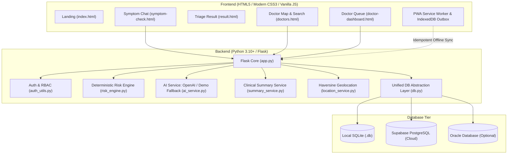

# AI Health Assistant – Smart Healthcare & Doctor Connect

> **Final-Year BCA (AI & Data Science) Project**  
> A complete, working, demo-ready web application providing conversational AI symptom triage, clinical risk assessment, controlled OTC guidance, nearby doctor discovery, and a pre-briefed consultation workflow with offline-first PWA resilience.

---

## 1. Quick Start

### Windows (One-Click)
Double-click `start.bat` **OR** run:
```powershell
python -m venv venv
.\venv\Scripts\activate
pip install -r requirements.txt
python run.py
```
Open **`http://localhost:5000`** in your browser.

### Mac & Linux
```bash
chmod +x start.sh
./start.sh
```
Open **`http://localhost:5000`** in your browser.

---

## 2. Demo User Accounts

| Role | Email | Password | Details |
| :--- | :--- | :--- | :--- |
| **Patient** | `patient@demo.com` | `Patient@123` | Rahul Sharma (Age 28, Male) |
| **Patient 2** | `patient2@demo.com` | `Patient@123` | Priya Gupta (Age 35, Female, Asthma) |
| **Doctor** | `doctor@demo.com` | `Doctor@123` | Dr. Amit Verma (General Physician, Dehradun) |
| **Doctor 2** | `doctor2@demo.com` | `Doctor@123` | Dr. Sneha Patel (ENT Specialist, Dehradun) |
| **Doctor 3** | `doctor3@demo.com` | `Doctor@123` | Dr. Rajesh Kumar (Pulmonologist, Dehradun) |
| **Admin** | `admin@demo.com` | `Admin@123` | System Administrator (Doctor Verification) |

*12 fictional practicing doctors in the Dehradun, Uttarakhand area are pre-seeded with coordinates for map discovery.*

---

## 3. System Architecture



---

## 4. Objective & Feature Traceability Table

| Objective (from Synopsis) | Working Feature Implementation | Primary Files |
| :--- | :--- | :--- |
| **Obj 1:** Natural language symptom intake | Conversational chat input accepting English, Hindi, and Hinglish | `chat.js`, `symptom-check.html`, `ai_service.py` |
| **Obj 2:** Conversational AI follow-up questions | Adaptive follow-ups (duration, severity, worsening, temperature; max 6) with quick-reply chips | `ai_service.py`, `chat.js` |
| **Obj 3:** Structured symptom extraction | JSON extraction parsing conversation into standard medical attributes | `ai_service.py` (`extract_structured_data_demo`) |
| **Obj 4:** Low / Medium / Urgent risk classification | Deterministic rule-based scoring + Hard Red Flags + AI opinion (AI cannot downgrade) | `risk_engine.py`, `red_flags.json`, `redflags.js` |
| **Obj 5:** Basic guidance & controlled OTC medicine info | Home-care tips & strictly controlled OTC remedies (Paracetamol, ORS) with "Not a prescription" notice | `guidance.json`, `medicines.json`, `result.js` |
| **Obj 6:** Nearby available doctor discovery | Haversine distance calculation, OpenStreetMap + Leaflet interactive map, availability filters | `doctors.py`, `location_service.py`, `doctors.js` |
| **Obj 7:** Short AI summary to selected doctor | Under-120-word clinical briefing attached to consultation requests | `summary_service.py`, `consultations.py` |
| **Obj 8:** Separate patient and doctor dashboards | Role-based authentication, patient history, doctor FIFO queue, and clinical advice tools | `patient-dashboard.html`, `doctor-dashboard.html` |
| **Obj 9:** Full stack integration | Python Flask + Vanilla JS + SQLite/Postgres + Leaflet Maps in a single runnable project | `run.py`, `app.py`, `db.py` |
| **Obj 10:** Extensibility for future ML & voice | Modular service structure with speech-to-text placeholders and clean service interfaces | `chat.html`, `drive_backup.py`, `docs/` |
| **Section 17 A:** Security Extras | CSRF validation, 5-minute login lockout, 30 calls/day AI rate limit, CSP & X-Frame-Options | `app.py`, `auth_utils.py` |
| **Section 17 B:** Doctor Verification | Doctors start pending; Admin dashboard approves/rejects before appearing in search | `admin.html`, `auth.py` |
| **Section 17 C:** Privacy & GDPR | "Delete my account & data" button, explicit consultation consent with timestamps | `profile.html`, `auth.py`, `consultations.py` |
| **Section 17 D:** Hindi / Hinglish Support | Emergency phrases (*seene mein dard*, *saans lene mein takleef*, *behosh*) detected client & server side | `red_flags.json`, `redflags.js`, `test_risk_engine.py` |
| **Section 17 E:** Google Drive Backups | Automated backup to Google Drive service account keeping last 7 archives | `drive_backup.py` |
| **Section 17 F:** Oracle Support | `schema.oracle.sql`, PL/SQL triggers, python-oracledb abstraction, thin mode compatibility | `db.py`, `ORACLE_SETUP.md` |
| **Section 17 G:** Progressive Web App (PWA) | `manifest.json`, `sw.js` app-shell caching, standalone installability | `sw.js`, `manifest.json` |

---

## 5. The Risk Engine Algorithm

The clinical risk algorithm operates on three distinct, hierarchical layers:

1. **Deterministic Red Flags (Safety Override):**
   - Evaluated **first** on raw text before any AI inference.
   - Matches keywords and regex for: Chest pain/pressure, breathing difficulty, fainting, seizures, stroke warning signs (FAST), severe bleeding, vomiting blood, anaphylaxis, suicidal ideation, fever $\ge$ 103°F with stiff neck/confusion, infant fever under 3 months, and pregnancy bleeding.
   - **Result:** Immediately escalates to **URGENT** (Score: 99). Prompts call to 112 / 108.

2. **Weighted Scoring Thresholds:**
   $$\text{Score} = \sum w_i \cdot x_i$$
   - Duration: $> 3\text{ days } (+1)$, $> 7\text{ days } (+2)$
   - Severity: Moderate $(+1)$, Severe $(+2)$
   - Worsening Trend: $(+2)$
   - Temperature: $\ge 101^\circ\text{F } (+1)$, $\ge 103^\circ\text{F } (+3)$
   - Patient Profile Vulnerability: Age $< 5$ or $> 60\text{ } (+1)$, Known Chronic Condition $(+1)$
   - **Classification:** Low: $0 - 2$, Medium: $3 - 5$, Urgent: $\ge 6$.

3. **AI Opinion Integration (Unidirectional Escalation Rule):**
   $$\text{Final Level} = \max(\text{Rule Level}, \text{AI Level})$$
   - The AI is permitted to escalate risk, but **is mathematically forbidden from downgrading a clinical rule classification**.

---

## 6. Offline-First Resilience (IndexedDB Outbox)

- When a device disconnects, changes are saved to an IndexedDB FIFO outbox.
- Every mutating request is tagged with a client-generated UUID (`client_id`).
- When network connectivity resumes, the outbox flushes items oldest-first.
- All backend endpoints are **idempotent**, preventing duplicate database records on retry.
- `redflags.js` evaluates emergency keywords locally in the browser, allowing the Urgent screen to function even during complete network loss.

---

## 7. Limitations & Future Work

1. **Custom Clinical ML Model:** Current extraction relies on GPT-3.5 or deterministic scripts. Future versions can fine-tune a specialized BioBERT or Llama-3-Med model on clinical datasets.
2. **Speech-to-Text & Dialect Processing:** Adding localized Indian voice input (Hindi, Garhwali, Kumaoni).
3. **Live WebRTC Teleconsultation:** Upgrading the asynchronous consultation messaging to peer-to-peer secure video calls.
4. **Electronic Health Records (EHR):** Integrating FHIR / ABDM (Ayushman Bharat Digital Mission) health IDs.

---

## 8. Academic & Synopsis References

1. **World Health Organization (WHO):** *Ethics and Governance of Artificial Intelligence for Health*, WHO Guidance, Geneva, 2021.
2. **US Food and Drug Administration (FDA):** *Clinical Decision Support Software – Guidance for Industry and Food and Drug Administration Staff*, 2022.
3. **LeCun, Y., Bengio, Y., & Hinton, G.:** *Deep Learning*, Nature, Vol. 521, pp. 436–444, 2015.
4. **Pedregosa, F., et al.:** *Scikit-learn: Machine Learning in Python*, Journal of Machine Learning Research, 12, pp. 2825–2830, 2011.
5. **Grinberg, M.:** *Flask Web Development: Developing Web Applications with Python*, 2nd Ed., O'Reilly Media, 2018.
6. **OpenAI:** *GPT-3.5 Turbo and Structured JSON Outputs Documentation*, OpenAI Developer Platform, 2023.
7. **OpenStreetMap Foundation:** *Leaflet: An open-source JavaScript library for mobile-friendly interactive maps*, 2023.
