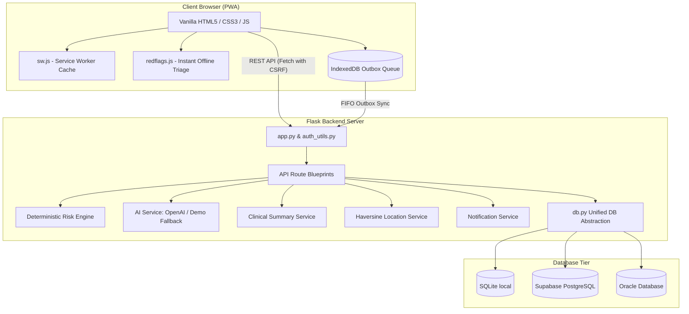
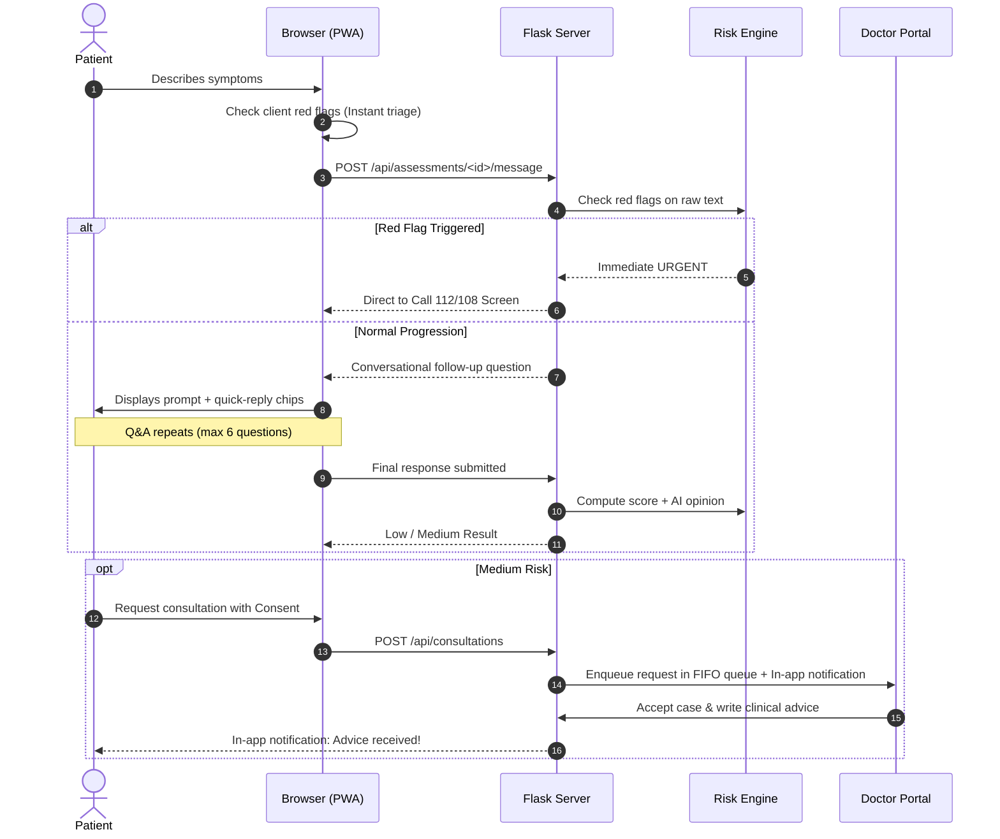

# AI Health Assistant – Architecture & Technical Design

## 1. System Architecture Overview

The application follows an **Offline-First, Lightweight Tiered Architecture** designed for high reliability, explainability, and speed:

---

## 2. Key Architectural Decisions

### A. Simplicity & Explainability for BCA Viva
- **No Heavy Frameworks:** Built with Plain HTML5, Modern CSS3 variables, and Vanilla JavaScript. Any BCA evaluator can inspect the code without dealing with Webpack, Babel, Vite, or node_modules.
- **One Unified Server Command:** Flask directly serves static assets and API routes on `http://localhost:5000`.

### B. Two-Layer Safety Architecture
1. **Pre-AI Deterministic Safety Filter:** The raw user input is checked against regex and keyword rules in `redflags.js` (client-side) and `risk_engine.py` (server-side) **before** invoking the AI.
2. **AI Escalation Rule:** The AI can elevate risk level (e.g. Low to Medium), but **can never downgrade** a level determined by clinical safety rules.

### C. Database Agnostic Abstraction Layer (`backend/db.py`)
Routes and business logic write SQL using `?` placeholders. The abstraction layer dynamically:
- Converts `?` to `%s` for PostgreSQL or `:1, :2` for Oracle.
- Automatically handles row-to-dictionary conversion.
- Manages auto-increment keys across `lastrowid`, `RETURNING id`, and Oracle `RETURNING ... INTO`.

### D. Offline-First Resilience (IndexedDB Outbox)
All client state modifications (chat messages, consultation bookings, doctor status toggles) are assigned a unique UUID `client_id` and queued into an IndexedDB FIFO outbox.
- When connection is restored, items are flushed oldest-first.
- All backend endpoints are **idempotent**, ensuring retries never produce duplicate entries.

---

## 3. Data Flow

